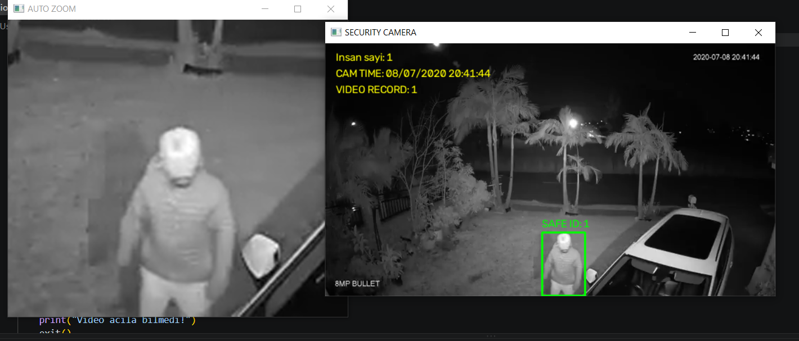

# AI Smart Surveillance System

An AI-powered surveillance system built with YOLO11, ByteTrack, OpenCV, and Tesseract OCR.

## Features

- Real-time person detection using YOLO11
- Multi-object tracking using ByteTrack
- Camera timestamp recognition using Tesseract OCR
- Individual video recording for detected persons
- SAFE / ALERT status classification based on predefined tracking IDs
- Security footage and zoomed person views

## Technologies

- Python
- YOLO11 (Ultralytics)
- ByteTrack
- OpenCV
- Tesseract OCR

## Project Structure

```text
AI-Smart-Surveillance/
├── main.py
├── requirements.txt
├── README.md
├── .gitignore
└── screenshots/
```

## Installation

1. Clone the repository:

```bash
git clone https://github.com/Nurlanclilov/AI-Smart-Surveillance.git
```

2. Install dependencies:

```bash
pip install -r requirements.txt
```

3. Install Tesseract OCR separately.

4. Place your video file named `video.mp4` in the project directory.

5. Run the application:

```bash
python main.py
```

## Important Notes

- The system uses tracking IDs for demonstration purposes.
- SAFE / ALERT labels do not represent real identity verification.
- A video file is not included in the repository. Users should provide their own video.

## Future Improvements

- Improve tracking stability
- Add a configurable trusted-person list
- Improve OCR accuracy
- Add event logging and reporting

## License

MIT License

## Demo




Technical Decisions

Individual recordings are automatically stopped when a tracked person is no longer detected.

This design prevents unnecessary video storage and avoids keeping inactive recordings open.
